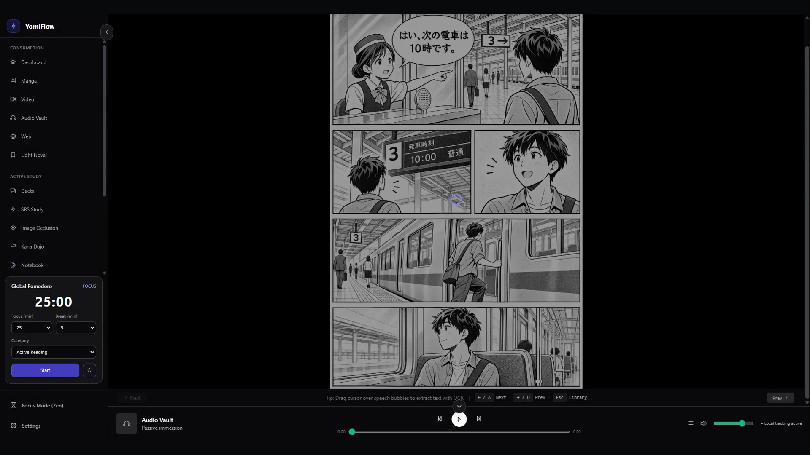
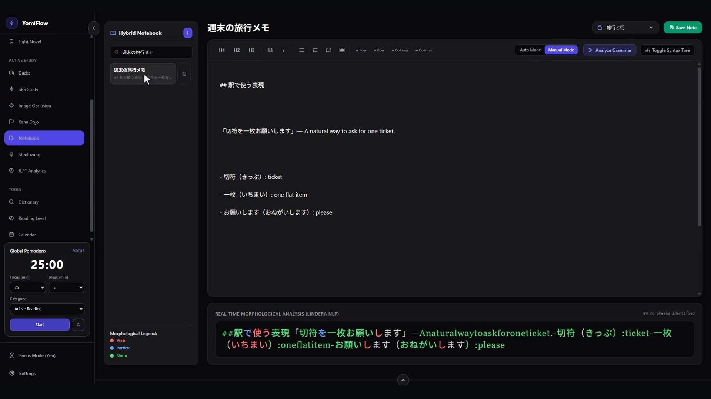
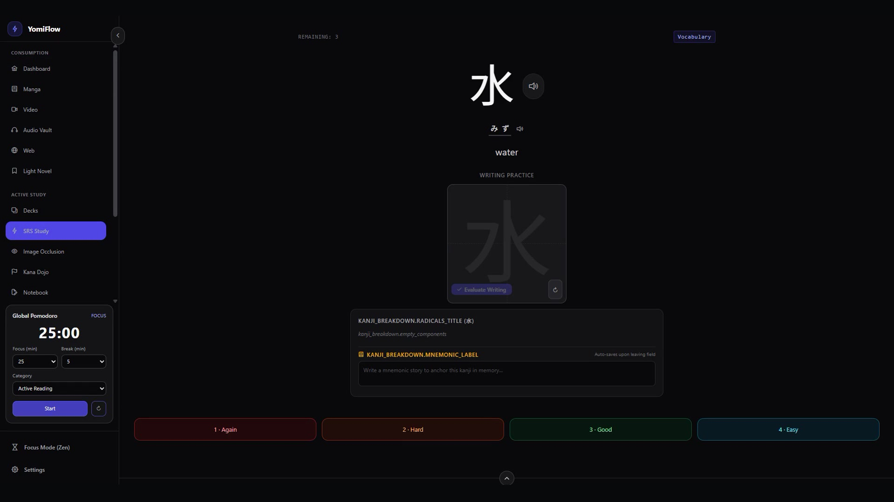

# YomiFlow Landing

The product website for [YomiFlow](https://github.com/ErickG123/yomiflow), an offline-first desktop workspace for learning Japanese. The site is built with Angular and is available in English, Portuguese, and Spanish.

## Product preview

These screenshots come from the app's silent feature walkthroughs. Open a feature page on the site to watch its full clip.

| Immersive reading | Japanese notebook | Spaced repetition |
| --- | --- | --- |
|  |  |  |

Feature demos are available on the [reader page](public/assets/videos/immersion.mp4), [notebook page](public/assets/videos/notebook.mp4), [SRS page](public/assets/videos/srs.mp4), and the pages for [Audio Vault](public/assets/videos/audio-vault.mp4), [Shadowing](public/assets/videos/shadowing.mp4), [Kana Dojo](public/assets/videos/kana.mp4), and [JLPT Analytics](public/assets/videos/analytics.mp4). The clips have no voice-over or audio track.

## Run locally

Requirements: Node.js 20+ and npm.

```bash
npm ci
npm start
```

The development server is available at `http://localhost:4200`.

## Quality checks

```bash
npm run lint
npm run build
```

## Project structure

- `src/app/features/home/`: home page and product overview.
- `src/app/features/feature-detail/`: localized feature pages and video player.
- `src/app/features/download/` and `src/app/features/pricing/`: download information and pricing.
- `src/app/core/`: language and SEO services.
- `src/app/shared/`: navigation, footer, and reusable UI.
- `public/assets/i18n/`: English, Portuguese, and Spanish translations.
- `public/assets/videos/`: silent feature demos and their poster images.

The app's current download page is a preview; platform installers will be linked when public release packages are available.

## Contributing

Components are standalone, with TypeScript, HTML, and SCSS kept in sibling files. Use route-level lazy loading for secondary pages. Commits follow [Conventional Commits](https://www.conventionalcommits.org/), and Husky runs formatting, lint, and commit-message checks.
